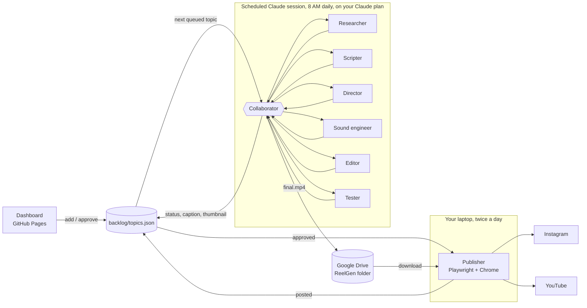

# ReelGen architecture

ReelGen turns a backlog of topics into 30-second vertical (9:16) infographic explainer videos with
voice narration, then posts them to Instagram Reels and YouTube Shorts after you approve them.



## The agents

| Agent | What it does | Built with |
|---|---|---|
| Collaborator | Runs the steps in order, passes each output to the next agent, retries, saves every hand-off to `runs/<date>-<topic>/` | The scheduled session following [ROUTINE.md](ROUTINE.md), with `python -m reelgen start / validate / preview / finish` |
| Researcher | Searches and reads the web, then returns sourced notes: definition, pain point, how it works, analogies, facts with URLs | The scheduled Claude session (web search and fetch) |
| Scripter | Writes a 65 to 80 word, 5-line script (hook, problem, define, steps, payoff), a version prepared for text-to-speech, the Instagram caption and hashtags, and the YouTube title and description | The scheduled Claude session |
| Director | Designs what's on screen for each scene by filling 5 fixed templates (words and icons), previews the frames and fixes the layout, so every video keeps the channel's style | The scheduled Claude session + the Pillow renderer in `reelgen/render/` |
| Sound engineer | Records one narration clip per scene with Google Cloud Text-to-Speech (Chirp 3 HD "Charon"), applying `config/pronunciations.json` | Google TTS REST API |
| Editor | Fits each scene's length to its line (speeds the voice up to 1.15x if needed, exactly 30 s total), renders the video, mixes the voice at -14 LUFS | ffmpeg |
| Tester | Checks size, frame rate, length, loudness, then transcribes the video with Google Speech-to-Text and compares it word by word with the script: overall and per-scene word error rate, words it heard differently (likely mispronounced), words per minute, long pauses, lines spilling into the next scene | Google Speech-to-Text REST API |
| Publisher | On your laptop, downloads approved videos from Drive and posts them through a dedicated Chrome profile signed in to the channel accounts | Playwright with installed Chrome |

### How the daily run works
A Claude Code scheduled task starts a fresh session every morning on your Claude plan (no API
bill). The session follows [ROUTINE.md](ROUTINE.md): `start` takes the next topic, the session
writes `research.json`, `script.json` and `scene_plan.json` itself (`brief` prints each agent's
instructions and schema), `validate` and `preview` check them, and `finish` records the voice,
renders, tests, uploads to Drive and marks the topic ready.

An API mode also exists (`python -m reelgen produce`, using `ANTHROPIC_API_KEY`) if you ever want
to run the same agents without a session; it isn't scheduled.

### Retries
- Script too long to fit 30 seconds: the scripter shortens it and tries again.
- Tester hears words wrong: the session writes respellings (e.g. "Kubernetes" as "koo-ber-net-eez")
  to `runs/.../respellings.json` and re-records (up to 2 tries). Good ones can be added to
  `config/pronunciations.json`.
- Anything else fails: the topic goes back to the queue and is retried once the next day, then
  marked failed with the error shown on the dashboard.
- A video that still fails a check is uploaded anyway but marked "Needs your review", with the
  failed checks listed, so you decide.

## Status flow

`queued` → `in_progress` → `ready` (waiting for your approval) → `approved` → `posting` → `posted`

Side exits: `failed` (after 2 attempts; Retry on the dashboard) and `rejected` (Reject or Re-make).

## Google Drive rules
- Each finished video is uploaded to a `ReelGen` folder.
- Posted to both Instagram and YouTube: deleted 3 days after the later post.
- Rejected: deleted right away.
- Never more than 5 videos. If it's full, the oldest posted video goes first. If all 5 are waiting
  for approval, production pauses (unapproved videos are never deleted).
- ReelGen uses the `drive.file` permission, so it can only see and delete files it created.

## Where things run and what they cost
| Piece | Runs on | Cost |
|---|---|---|
| Dashboard | GitHub Pages | Free |
| Pipeline (research, script, design, render, test) | A scheduled Claude Code session | Included in your Claude plan: one short session a day counts toward its usage limits |
| Tests | GitHub Actions | Free |
| Voice | Google Text-to-Speech | Free tier covers 1M Chirp 3 HD characters a month; one video is about 500 |
| Narration check | Google Speech-to-Text | Free tier covers 60 minutes a month; 60 videos is 30 minutes |
| Drive | Your Google account | Free |
| Publisher | Your Windows laptop | Free |

## Repository layout
```
backlog/topics.json        the backlog (dashboard, pipeline and publisher all edit it)
docs/                      the dashboard (deployed to GitHub Pages)
reelgen/                   the pipeline: agents/, render/, gcloud/, backlog.py, retention.py
config/pronunciations.json how the voice should say tricky words
runs/<date>-<topic>/       each video's research, script, scene plan, test report, caption, thumbnail
publisher/                 the laptop publisher (Playwright)
scripts/google_auth.py     one-time Google Drive sign-in helper
fixtures/                  the RAG sample, used by tests and `python -m reelgen demo`
```

## A note on browser posting
Posting through a browser robot is against Instagram's and YouTube's terms and can get accounts
challenged or locked, especially new ones. ReelGen lowers the risk by running on your own laptop
and home connection, in a real Chrome profile you signed into yourself, posting at most a couple
of videos per run with pauses between steps. If an account gets flagged, the safer path is the
official APIs (YouTube Data API; Instagram Graph API with a Creator or Business account linked to a
Facebook Page). The publisher is a separate piece, so it can be swapped without touching the rest.
